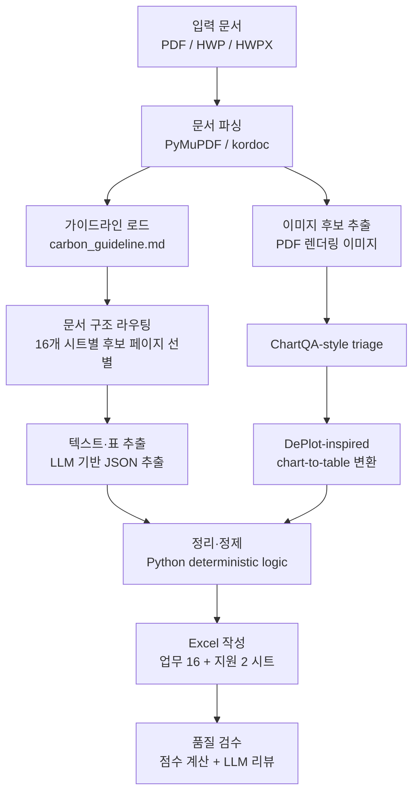

# 가이드라인 기반 지자체 탄소중립 계획 정보 추출 시스템

환경부 「지자체 탄소중립 녹색성장 기본계획 수립 및 추진상황 점검 가이드라인」(`carbon_guideline.md`) 기반으로 지자체 보고서에서 **16개 표준 시트**의 구조화 데이터를 추출해 Excel 파일로 정리하는 Python 프로젝트입니다.

PDF를 주 입력으로 지원하며, HWP/HWPX 문서는 `kordoc`를 통해 텍스트와 표를 읽어 파이프라인에 연결합니다.

## 2026-11-03: 사실 식별 계약·표 머리글 경로 실험

`codex/trace-table-contracts`에서 TRACE의 관측 단위·근거 계약과 DeepTable의 행·열
머리글 경로 **표현**을 선택적으로 적용했습니다. 학습이나 attention 변경은 포함하지 않습니다.
모델·추론 강도·실제 `.env`는 유지합니다.

- 사업/부문·지표·목표범위·연도/기간·단위 차원/배율·계획 문맥을 공통 식별 기준으로 사용합니다.
  추출·정제·배치 재개·병합에서 같은 기준을 사용하며, 지표별 사실ID와 원문 셀 참조를 기록합니다.
- 표의 다단 머리글과 명시 병합 셀을 원본 행·열 위치가 있는 경로로 전달합니다.
  기존 페이지 배치를 유지하고, 보조 입력 길이를 제한하며, 복원 불가능한 머리글은 진단으로 남깁니다.
- `FACT_CONTRACT_MODE=off|audit|enforce`와 `TABLE_HEADER_PATHS_ENABLED=0|1`은 독립 설정이며 기본 OFF입니다.
  enforce에서 잘못된 값/지표/기간/단위/셀 연결은 원행과 사유를 보존해 보류합니다.
  셀 근거가 없는 과거 응답은 검토 대상으로 남기며 판독 성공으로 간주하지 않습니다.
- 실제 저장 셀 재조회와 `*_fact_contracts.json`을 연결했습니다. 저장 응답 고정 비교 실행기는
  `scripts/replay_fact_contracts.py`이며, 새 모델 호출 없이 기존·진단·적용 결과를 별도 파일로 만듭니다.

구현·실행·지원 한계와 비교 조건은 [실험 안내](docs/trace_table_experiment.md)를 참고하세요.
연결·회귀 검증과 실제 모델 정확도 향상은 구분합니다.

## 2026-10-29: 저장 응답 고정·감축목표 중복 손실 보완·실패 배치 복구

감축목표 정리에서 목표범위·기준연도·단위를 구분하고 동일 사실의 출처를 합칩니다.
값 충돌은 원행과 검토 사유를 남겨, 먼저 나온 행 때문에 다른 목표가 사라지지 않도록 했습니다.
모델·추론 강도·추출 지침·실제 `.env`는 변경하지 않았습니다.

별도 복구 실행기는 성공 응답과 기존 Excel을 고정하고 실패 텍스트 배치만 제한적으로 호출합니다.
원본 배치 지문 검증, 파싱 전 원응답 저장, 기존 셀 보존, 재개 시 응답 재사용과 실제 신규 셀 저장 검증을 연결했습니다.
Vision은 재호출하지 않으며, 충돌·원문 미확인 필드·빈 계획 행은 사유를 보존합니다.
이전 전체 원시 결과를 완전히 재구성하는 기능이나 전체 정확도 채점과는 구분합니다.

강원 10월 28일 실행의 성공 194배치를 보존하고 실패 1배치를 실제 재호출했습니다.
기존에 고정한 개발용 99개 수치 표본에서 도시가스 계획 6항목과 부문별 목표 4항목의 저장 위치가 보완됐습니다.
감축목표의 단위 열 부재·기존 충돌은 남아 있으므로 전체 정확도 향상 수치로 해석하지 않습니다.
실행·산출물·보류 기준은 [저장 응답 복구 안내](docs/saved_extraction_recovery.md)를 참고하세요.

관련 연결·회귀 검증은 신규 10개를 포함해 333개 통과했습니다. 전체 테스트에는
기존 Windows 가짜 CLI 경로 처리 3건, 구형 시트명 기대 1건의 실패와 구형 요약 함수 import 오류가
별도로 남아 있으며, 수정 전 커밋에서도 같은 문제를 확인했습니다. 이번 범위에서 해당 구형 기능을 이식하지는 않았습니다.

## 2026-10-28: 최종 검토의 규칙·검증 범위·정확도 구분

LLM이 고르던 `우수·보통·미흡` 전체 등급을 제거하고, 저장 후 검사로 결정한 **데이터 규칙 검토 상태 / 원문 검증 범위 / 선택 골든 평가 상태**를 따로 표시합니다. 출처 연결 미확인과 원문 표현 미확인은 검증 한계로 구분하며, 골든 OFF/미등록을 품질 감점 사유로 삼지 않습니다. 실제 규칙 위반은 계속 검토 대상으로 남깁니다.

LLM의 기존 1회 호출은 확인된 규칙과 검토 순서에 대한 참고 의견으로 유지합니다. 구형 응답의 등급이나 자유 서술은 최종 상태·점수에 사용하지 않고 원응답으로 보존합니다. 로그·품질 보고서·`run_outcome.final_review`에 같은 상태를 기록합니다. 모델·추론 강도·추출 프롬프트·업무 셀·재시도 조건과 실제 `.env`는 유지했습니다. 강원 골든 OFF 테스트는 기존 실행 명령의 평가 옵션을 `--evaluation-mode off`로 지정하면 됩니다. 원문 감사의 2행 머리글 처리는 별도 보완 범위입니다.

- 새 상태 분리·구형 응답·실패 처리와 기존 추출/저장/감사/2차 판독을 합쳐 **323 passed**. 실제 모델 호출 없이 기존 강원 자료의 OFF 표시를 확인하고 원본 해시를 보존했습니다.

## 2026-10-27: 실제 저장 결과의 품질 검사·골든 평가 연결

시트 존재 위주의 종전 100점 표시는 재시도용 최소 구조 검사로 구분하고, 최종 Excel을 다시 읽어 필수 정보·비금액 예산·지역/기간/단위·중복/충돌·출처와 저장 일치를 검사합니다. 확정 규칙 위반·의심·미평가를 구분하고 품질 보고서(JSON/Markdown), 셀별 진단(JSONL), `pipeline_audit`와 `run_outcome`에 연결했습니다. 업무 데이터나 모델·추론 강도·`.env`는 변경하지 않습니다.

승인된 골든은 원문/골든 해시 확인 후 자동 평가하고, 미등록·미승인 자료는 정확도를 null과 사유로 표시합니다. 과거 v1 참조 점수와 순서 불변·단위 동치·모호성 보류를 적용한 v2 점수는 별도로 보존합니다. 서울의 기존 draft 골든은 명시 허용이 필요하며 경기·강원에 서울 골든을 적용하지 않습니다. [설정·실행·판정 기준](docs/saved_quality_evaluation.md)을 참고하세요. 독립 재평가 실행기는 후속 범위입니다.

- 외부 모델 호출 없는 연결·회귀 검증 **301 passed**. 평가 ON/OFF의 추출 요청·업무 셀 동일성과 보고 실패 시 Excel 보존을 확인했습니다.
- 기존 두 전체 실행의 v1 셀 점수 54.59%·41.40%를 재현하고 원본 파일 해시를 보존했습니다. 이는 새 모델 판독 실측과 구분합니다.

## 2026-10-26: 2차 예산의 계획구분·부문 연결

저장 원문의 계획 절 제목·사업 관리번호·부문 머리글과 기존 사업목록을 연결해, 명시 근거가 일치하는 경우에만 2차 예산 행의 빈 분류를 채웁니다. 사업·절 경계를 넘는 승계를 막고, 충돌은 사유와 근거를 남기며 기존 값을 유지합니다. 모델·추론 강도·`.env`·금액 판독 프롬프트는 유지했습니다.

- 기존 실응답 22개를 `--reuse-run`으로 재평가해 새 모델 호출 없이 실제 Excel 저장을 검증했습니다. 원래 실행 폴더와 기준 업무 셀은 보존했습니다.
- 확정 24건에서 계획구분 공란 17→0, 부문 공란 17→4. 기존 부문값 1건에도 새 충돌을 기록했습니다. 금액·연도 등은 유지했고, 30개 분류 공란을 보완했습니다.
- 신규 연결·경계·충돌·응답 재사용과 기존 경로를 합쳐 **269 passed**입니다. 분류 연결 집계와 전체 정확도 실측은 구분합니다.

재현 명령·근거 원장·남은 충돌은 [2차 예산 분류 보완 안내](docs/second_pass_context.md)에 기록했습니다.

## 2026-10-24: 확정 누락의 제한적 2차 판독·병합

별도 브랜치 `codex/second-pass-reading-merge`에 `scripts/run_second_pass.py`를 추가했습니다. 기존 `tmp2`·독립 감사 브랜치·`.env`·1차 모델 설정을 보존합니다. 첫 범위는 원문 검토로 확정한 연간 예산액이며, 현재 확정 24건은 표 22개로 묶습니다.

- 확정 목록과 원문 검토·PDF·기준 Excel·감사 원장 해시를 검증한 뒤, 원본 표 이미지만 재판독합니다. 예상 금액을 모델에 알려주지 않습니다. 모델은 기준 실행 매니페스트에서 읽으며 추론 강도를 덮어쓰지 않습니다.
- 기본은 dry-run입니다. `--execute`에서만 호출하며 기본 4회·300초, 기준 실행 시간의 20% 이내로 제한합니다. 성공 응답은 보존하고 재개 시 재사용합니다. 실패/중단 표를 자동 재시도하지 않습니다.
- 근거·사업·연도·재원·단위·금액이 맞는 후보만 기존 Organizer·의미 검증·원문 대조·Excel 저장으로 연결합니다. 중복은 차단하고 충돌은 보류합니다. 새 Excel을 재조회해 기존 셀과 신규 반영 셀을 확인합니다.
- 이 연결 과정에서 정수형 출처 페이지를 측정값으로 검사하던 원문 대조 문제를 수정하고, Excel 재작성 시 기존 빈 셀의 자료형도 보존하도록 보완했습니다.

실행 명령·예산·재개·감사 파일·검증 범위는 [2차 판독 실행기 안내](docs/second_pass_runner.md)를 참고하세요. 고정 응답의 연결 검증과 실제 모델 정확도 실측은 구분합니다. 기존 독립 감사의 `SOURCE_COVERAGE_MODE=audit`만 켜서는 재판독이 발생하지 않습니다.

## 2026-10-24: 새 표본에서 발견한 네 가지 감사 규칙 보완

별도 페이지 표본 32건 검토에서 확인한 **수익금의 예산 오분류, 차량 동력원 괄호 생략, 연간 공란/기간 합계, 사업명 포함 반복 연도 머리글**을 공용 감사 모듈에서 수정했습니다. 독립 실행과 `main.py --source-coverage audit`의 저장 후 감사에 함께 적용됩니다. 최초 모델 판독·정제·업무 Excel 값은 변경하지 않습니다.

- 수입/수익 문맥은 원문 금액과 기존 ID를 보존하며 예산 누락 후보에서 제외합니다. 수입과 지출 근거가 충돌하면 보류합니다.
- 차량 동력원 열거의 생략명은 출처·연도·재원별 금액까지 확인할 때만 연결합니다. 지역/단계 괄호와 경쟁하는 세부 사업은 임의 병합하지 않습니다.
- 공란은 단위 판정 전에 구분하고 기간 합계는 별도 보존합니다. 반복 머리글의 연도 문자열은 측정값이나 재판독 후보로 세지 않습니다.
- **204 passed**, 기존 40/40 및 추가 32/32가 기대 분류와 일치했습니다. 수정 전 32건의 28/32 결과와 원문 검토 파일도 그대로 보존했습니다. 32건은 이번 수정에 사용됐으므로 이후 결과는 개발 회귀 검증입니다.

전체 저장 결과 재감사는 추가 모델 호출 없이 완료했습니다. 누락 후보 280→269는 기존 반영 1건과 수익금 10개 연도 항목의 재분류이며, 실제 Excel 데이터가 늘었다는 뜻은 아닙니다. [V3 수정·검증 안내](docs/source_coverage_rules_v3.md)에 조건·결과·재실행 명령을 기록했습니다. `.env` 변경이나 전체 PDF 재판독은 이번 수정 확인에 필요하지 않습니다.

## 2026-10-24: 누락 후보 분류 규칙 보완

독립 감사 브랜치에서 원문 검토 결과에 따라 **분류 규칙만** 보완했습니다. 원본 프로젝트·`tmp2`·모델·추론 강도·`.env`·업무 Excel은 변경하지 않았습니다.

- 사업명 문자열이 달라도 표 제목·페이지·명시 세부 사업 열로 연결되는 예산을 대조합니다. 감축량의 상하위 사업은 원문 활동량·연차별 계획·관리번호·출처가 함께 확인될 때만 연결합니다.
- CO2/CO2eq 차이는 `unit_review`, 원문 공란·페이지 대리 이미지는 `excluded`, 단위·사업 귀속 근거 부족은 이유별 보류로 구분합니다. 원래 읽힌 단위 문맥만 위치 근거와 함께 재사용합니다.
- 오프라인 연결·회귀 **178 passed**, 기존 원문 검토 표본 **40/40**이 수정한 분류와 일치했습니다. 같은 표본을 규칙 개발에 사용했으므로 전체 정확도나 새 표본의 정확도 측정 결과는 아닙니다.
- 기존 결과 재감사는 모델 호출 없이 완료했습니다. 이번 수정 확인을 위한 `main.py` 재판독은 필요하지 않으며, 실제 업무 값 보완이나 새 실행의 단계별 기록이 필요할 때 별도로 실행합니다.

판정 변경 내역·남은 문제·독립 재평가 및 선택적 전체 실행 명령은 [분류 규칙 V2 안내](docs/source_coverage_rules_v2.md)를 참고하세요. 자동 2차 추출·Excel 값 수정은 아직 추가하지 않았습니다.

## 2026-10-23: 원문 누락 후보 독립 감사

`tmp2`의 초기 V9 통합 복원본을 보존하고, 별도 작업 폴더·브랜치 `codex/source-coverage-audit`에 감사 실행기를 추가했습니다. 모델·추론 강도·`.env`·라우팅·배치·프롬프트·업무 값은 변경하지 않습니다.

- 기존 문서 객체의 명시적인 사업/과제·연도·값·단위를 항목화하고, 원시 추출 → 정제 → **재개방한 실제 Excel 셀**의 보존 여부를 기록합니다. 첫 지원 범위는 `10_정량감축량`, `11_재정투자계획`, `12_대응기반강화`입니다.
- 기본 `SOURCE_COVERAGE_MODE=off`; 새 `main.py --source-coverage audit`는 감사 기록만 추가합니다. 기존 결과는 `scripts/audit_source_coverage.py`로 **모델 호출·문서 재판독 없이** 검사할 수 있습니다.
- `<실행명>_missing_candidates.jsonl`, `_coverage_summary.json`을 저장합니다. Supervisor는 기존 `_pipeline_audit.json`·`_run_outcome.json`에 요약/경로를 연결하며, 독립 실행은 원본 감사 파일을 수정하지 않고 새 연결용 `_pipeline_audit.json`을 생성합니다.
- 빈 값·기간 합계·불명확한 귀속은 누락으로 단정하지 않습니다. 정제 격리, 수치 충돌, 다른 시트 반영, 해석 불가를 구분합니다. 누락 후보의 재추출·자동 수정은 하지 않습니다.

오프라인 연결·회귀 **153 passed**. 감사 OFF/ON의 모델 입력·호출 수와 16개 업무 시트의 셀 값/자료형이 동일함을 확인했습니다. 실제 모델 정확도 향상을 측정한 결과는 아닙니다. 보존 확인, 실행 명령, 과거 결과 감사의 범위/한계는 [독립 감사 안내](docs/source_coverage_audit.md)를 참고하세요.

## 2026-10-10: main 기반 V9 선별 통합

main `baceb021`을 기준으로 V9 `a2cb6bc`의 객체·전망 키·OCR·평가 기반을 선별 이식했습니다. 작업 브랜치는 `codex/main-v9-selective-integration-20261010`이며, 기존 개인 작업본이나 원격 main을 교체하지 않았습니다. 모델명·provider·reasoning 설정도 변경하지 않았습니다.

- 저장 OCR을 가져오는 데서 끝내지 않고, 대응이 확실한 **변경 객체 → 관련 시트 재추출 → 정제 → 업무 Excel 셀**로 연결했습니다. Directory 백엔드는 OCR 모델을 직접 실행하지 않습니다.
- 전망범위·시나리오·세부부문·단위를 구분하고, 값 충돌·모호한 귀속·잘못된 축의 원행과 사유를 보존합니다. 빈 범위는 후보가 유일하고 공개 필드도 충돌하지 않을 때만 합칩니다.
- 객체 배치·문자/셀 상한·체크포인트는 선택 기능입니다. 기본 객체/OCR 추가 호출은 비활성 상태이며, 기존 추출·Vision 호출 설정을 유지합니다.
- 16개 업무 시트 + `16_시각자료목록` + `17_검증리포트`를 저장합니다. 업무 시트에는 출처 열이 추가되며 `PROVENANCE_ENABLED=0`이면 부가 출처 열을 숨깁니다. `05_배출전망`의 `전망범위`는 유지됩니다.
- `<출력명>_pipeline_audit.json`은 run-state OFF에서도 저장됩니다. 객체, 배치 실패, OCR 보완, 충돌, 격리 원행, 축/범위 불확실성과 원문 존재 진단을 포함합니다. 저장 실패는 경고하고 이미 저장한 Excel을 보존합니다.

기능별 적용 조건·통합/보류 판단·실제 테스트 결과는 [통합 보고서](docs/main_v9_integration_report.md)를, 전망 계약은 [세부 설명](docs/integration_forecast_contract.md)을 참고하세요. 합성 fixture의 연결 검증과 실제 모델 정확도·운영 속도는 구분합니다. V9 전체 캐시/quota 복구·gap-fill·보조검수·참조자료 보강은 이번에 통째로 이식하지 않았습니다.

### 재실행 가능한 오프라인 검증

프로젝트 의존성과 pytest가 설치된 Python에서 실행합니다. 모델 호출은 fixture로 대체하며, PDF 파싱·병합·정제·Excel 저장은 실제 코드입니다.

```powershell
$env:PYTHON_DOTENV_DISABLED = "1"
$env:PYTEST_DISABLE_PLUGIN_AUTOLOAD = "1"
py -m pytest tests/test_extraction_foundation.py tests/test_main_v9_end_to_end.py tests/test_main_v9_forecast_contract.py tests/test_v9_ocr_loader_contract.py 졸업프로젝트_실험1/tests -q --basetemp .pytest_local_check

$stamp = Get-Date -Format "yyyyMMdd_HHmmss_ffffff"
py scripts/offline_connection_demo.py --output-dir ".\output\offline_connection_$stamp"
py scripts/run_ocr_fixture_demo.py --output-dir ".\output\ocr_fixture_$stamp"
```

테스트 종료 후 실제 실행에서 기존 `.env`를 읽으려면 `Remove-Item Env:PYTHON_DOTENV_DISABLED -ErrorAction SilentlyContinue`를 실행하세요. 새 `.env.example`은 새 기능 설명용이며 기존 `.env`의 대체본이 아닙니다. worktree에 `.env`가 없으면 dotenv가 상위 작업 폴더에서 찾을 수 있으므로 실제 실행 전에 적용 경로를 확인하세요.

### 저장 OCR을 사용하는 실제 실행

다음 명령은 기존에 설정된 모델을 사용하여 **실제 추출 호출**을 수행합니다. OCR 서버 자체를 시작하거나 자동 VLM fallback을 실행하지 않습니다.

```powershell
py main.py "문서.pdf" --output ".\output\통합검증.xlsx" `
  --selective-ocr --ocr-results-dir ".\ocr_results"
```

추가 선택 옵션은 `--object-batching`, `--batch-max-chars`, `--batch-max-table-cells`, `--semantic-routing audit|apply`, `--run-state-dir`, `--resume`입니다. `audit`는 의미 진단만 수행하고 `apply`는 근거가 충분한 이동만 적용합니다. 같은 PDF·OCR 파일·프롬프트·설정·구현의 성공 추출 배치만 재개합니다. 최종 LLM 검수와 원문 존재 진단은 무제한 자동 수정 루프가 아닙니다.

## 2026년 6월 업데이트: 가이드라인 기반 16시트 구조 전환

전체 파이프라인을 `carbon_guideline.md` 기반으로 재설계했습니다.

- **16개 표준 시트**: 가이드라인 §5.2절에 정의된 문서메타, 계획개요, 지역여건, 배출현황(지역/관리권한), 배출전망, 감축목표, 비전전략, 감축사업목록, 연차별이행계획, 정량감축량, 재정투자계획, 대응기반강화, 이행관리환류, 점검실적, 변경과제 + 시각자료목록
- **가이드라인 마크다운 직접 로드**: HWP 파싱 없이 `carbon_guideline.md`에서 시트별 보조 지침을 바로 생성
- **기본 LLM 백엔드**: `config.py` 기본값은 Gemini API (`GEMINI_API_KEY` 필요). 환경변수/기존 CLI로 로컬 에이전트 선택 가능. 일부 기존 CLI 안내의 Codex 기본 문구와 불일치하므로 실행 시 기존 provider를 명시적으로 확인하세요.
- **로컬 에이전트 지원**: `--agent codex` 또는 `--agent claude`로 로컬 CLI 사용 가능
- **이미지 분석**: 기본 포함. 그래프·표 이미지에서 수치를 추출해 해당 시트에 병합

## 주요 기능

- PDF, HWP, HWPX 입력 지원
- `carbon_guideline.md` 기반 16개 표준 시트 자동 추출
- 문서 구조 라우팅으로 시트별 관련 페이지 선별 (16개 카테고리)
- Gemini API / Codex CLI / Claude Code CLI 선택 가능
- ChartQA-style 이미지 triage + DePlot-inspired chart-to-table 변환
- 부문명 정규화, 중복 제거, 달성여부/사업유형 코드 정규화
- 16개 업무 시트와 시각자료목록·검증리포트 Excel 생성 (현재 총 18개)

## 처리 흐름



## 프로젝트 구조

```text
졸업프로젝트/
├─ main.py                    # CLI 진입점
├─ config.py                  # 모델, 배치, 라우팅, 이미지 분석 설정
├─ requirements.txt           # Python 의존성
├─ package.json               # kordoc(Node.js) 의존성
├─ install.bat                # Windows 설치 보조 스크립트
├─ agents/
│  ├─ guideline_agent.py      # 환경부 가이드라인/스키마 관리
│  ├─ extractor_agent.py      # 텍스트·표 추출
│  ├─ image_agent.py          # 이미지 triage 및 그래프 표 변환
│  ├─ organizer_agent.py      # 정제·정규화·이상치 처리
│  ├─ excel_agent.py          # Excel 작성 에이전트
│  └─ supervisor.py           # 전체 파이프라인 조율
└─ utils/
   ├─ llm_client.py           # Codex/Claude Code 호출, JSON 파싱, 재시도
   ├─ pdf_reader.py           # PDF 파싱
   ├─ hwp_reader.py           # HWP/HWPX 파싱(kordoc)
   └─ excel_writer.py         # openpyxl 기반 Excel 생성
```

## 설치

### 1. Python 패키지

Python 3.10 이상을 권장합니다.

```powershell
py -m pip install -r requirements.txt
```

`py -m ...` 실행 시 `No installed Python found!`가 나오면 Python 런타임이 설치되어 있지 않거나 Windows Python Launcher가 실제 Python을 찾지 못하는 상태입니다. 이 경우 [python.org](https://www.python.org/downloads/windows/)에서 Python 3.11 이상을 설치하고, 설치 화면에서 `Add python.exe to PATH`를 체크한 뒤 새 PowerShell을 열어 아래 명령으로 확인합니다.

```powershell
py -0p
py --version
```

또는 Windows에서:

```powershell
.\install.bat
```

### 2. HWP/HWPX 지원용 Node 패키지

PDF만 사용할 경우 필수는 아니지만, HWP/HWPX 입력 또는 가이드라인 HWP를 쓰려면 Node.js 18 이상과 `kordoc`가 필요합니다.

```powershell
npm install
```

프로젝트는 가능한 경우 전역 `npx`보다 로컬 `node_modules/.bin/kordoc.cmd`를 우선 사용합니다.

### 3. LLM 백엔드 준비

기본 실행은 **Gemini API**를 사용합니다. `.env` 파일 또는 환경변수에 API 키를 설정하세요.

```text
GEMINI_API_KEY=AIzaSy...
```

Gemini SDK가 필요합니다:
```powershell
py -m pip install google-genai
```

로컬 에이전트를 사용하려면 아래처럼 설정합니다:

```text
LLM_PROVIDER=codex    # Codex CLI 사용
# 또는
LLM_PROVIDER=claude   # Claude Code CLI 사용
```

로컬 에이전트는 각각 로그인 상태가 필요합니다:
```powershell
codex --version
# 또는
claude --version
```

## 실행

### 기본 실행 (Gemini API)

```powershell
py main.py "서울특별시_탄소중립계획.pdf" -o "서울_결과.xlsx"
```

### Codex CLI로 실행

```powershell
py main.py "서울특별시_탄소중립계획.pdf" --agent codex -o "서울_결과.xlsx"
```

### Claude Code CLI로 실행

```powershell
py main.py "서울특별시_탄소중립계획.pdf" --agent claude -o "서울_결과.xlsx"
```

### 이미지 분석 제외

이미지 Vision 호출이 느리거나 비용을 줄이고 싶을 때:

```powershell
py main.py "서울특별시_탄소중립계획.pdf" --no-images -o "서울_결과.xlsx"
```

### 전체 페이지 스캔 (라우팅 누락 방지)

```powershell
py main.py "서울특별시_탄소중립계획.pdf" --full-scan -o "서울_결과.xlsx"
```

### 주요 옵션

| 옵션 | 설명 |
|---|---|
| `input_path` | 입력 문서 경로. PDF, HWP, HWPX 지원 |
| `-o`, `--output` | 출력 Excel 파일 경로 |
| `-g`, `--guideline` | 환경부 가이드라인 HWP/HWPX 경로 |
| `--agent` | LLM 백엔드: `codex`, `claude`, `auto`, `gemini` |
| `--agent-model` | 로컬 에이전트/레거시 Gemini 모델명 |
| `--agent-timeout` | 로컬 에이전트 1회 호출 제한 시간(초) |
| `-k`, `--api-key` | 레거시 Gemini 백엔드용 API 키 |
| `-r`, `--retries` | 품질 미달 시 파이프라인 재시도 횟수 |
| `-v`, `--verbose` | 상세 로그 출력 |
| `--no-images` | 이미지·그래프 분석 생략 |

## 출력 Excel

생성 파일은 `carbon_guideline.md` §5.2절 기준 17개 시트로 구성됩니다.

| 시트 | 내용 |
|---|---|
| `00_문서메타` | 계획명, 지자체, 계획기간, 기준연도, 목표연도 |
| `01_계획개요` | 수립배경, 법적근거, 추진체계, 추진경과 |
| `02_지역여건` | 자연/인문/경제/에너지 지표 (자동차, 에너지 포함) |
| `03_배출현황_지역` | GIR 기준 직접·간접·흡수원 배출량 |
| `04_배출현황_관리권한` | 지자체 관리권한 인벤토리 |
| `05_배출전망` | BAU 및 시나리오별 전망값 |
| `06_감축목표` | 총괄·부문별 감축목표, 감축률 |
| `07_비전전략` | 비전문구, 추진전략, 세부전략 |
| `08_감축사업목록` | 감축대책 세부사업, 관리번호, 성과지표 |
| `09_연차별이행계획` | 사업별 연도별 목표물량 및 계획 |
| `10_정량감축량` | 감축원단위 기반 정량 감축량 산정 |
| `11_재정투자계획` | 부문별·재원별·연도별 예산 |
| `12_대응기반강화` | 적응/공유재산/교육/녹색성장 등 8개 영역 |
| `13_이행관리환류` | 점검체계, 담당조직, 절차, 기한 |
| `14_점검실적` | 연도별 이행실적, 달성여부, 사업유형 |
| `15_변경과제_조치` | 변경사업, 미달성 사유, 조치계획 |
| `16_시각자료목록` | 이미지·그래프 판독 결과 추적 |

## 현재 주요 설정

`config.py`에서 실행 시간과 정확도 균형을 조정할 수 있습니다.

```python
LLM_PROVIDER = "gemini"        # 기본 백엔드 (gemini/codex/claude/auto)
LOCAL_AGENT_MODEL = ""
LOCAL_AGENT_TIMEOUT = 900
GEMINI_API_KEY = ""            # .env 또는 환경변수로 설정

BATCH_SIZE = 15                # 배치당 페이지 수

DOCUMENT_ROUTE_CONTEXT_PAGES = 1
DOCUMENT_ROUTE_MIN_SCORE = 3

MAX_IMAGES = None              # 기본값: triage 통과 이미지 전수 분석
IMAGE_TRIAGE_ENABLED = True
IMAGE_TRIAGE_MIN_SCORE = 5
IMAGE_CHART_TABLE_EXTRACTION = True
IMAGE_CHART_MERGE_MIN_CONFIDENCE = "medium"
```

권장값:

- 최종 산출용: 기본값 그대로 `MAX_IMAGES = None`으로 이미지 전수 분석
- 빠른 테스트: `MAX_IMAGES = 30~50` 또는 `--no-images`
- 라우팅 누락이 의심될 때: `--full-scan` 또는 `FULL_DOCUMENT_SCAN=1`
- JSON 파싱 실패가 잦을 때: `BATCH_SIZE = 10~15`

## 동작 방식

### 문서 파싱

PDF는 PyMuPDF로 텍스트, 표, 이미지 후보를 추출합니다. HWP/HWPX는 `kordoc`를 subprocess로 호출해 Markdown/JSON 결과를 읽고, 기존 `PDFContent` 구조로 변환합니다.

### 가이드라인 반영

가이드라인 HWP가 제공되면 `GuidelineAgent`가 본문을 시트별 키워드로 검색해 관련 지침 조각을 추출 프롬프트에 추가합니다. 파싱에 실패하거나 관련 지침이 없으면 내장 스키마만 사용합니다.

### 텍스트 추출

전체 문서를 그대로 LLM에 넣지 않고, 시트별로 관련성이 높은 후보 페이지를 먼저 고릅니다. 이후 후보 페이지를 `BATCH_SIZE` 단위로 묶어 선택된 로컬 에이전트에 JSON 전용 프롬프트로 전달합니다.

라우팅 로그의 후보 페이지 수와 최종 추출 행 수는 다른 값입니다.

```text
문서 구조 라우팅 완료(시트별 후보 페이지 수): {'ghg': 180, ...}
완료. 누적: {'ghg': 75, ...}
```

첫 번째는 LLM에 보낼 후보 페이지 수이고, 두 번째는 실제 추출된 JSON 행 수입니다.

### 이미지 분석

이미지가 많은 PDF에서도 기본값은 `MAX_IMAGES=None`이므로 triage 통과 이미지를 전수 분석합니다.
속도 때문에 일부만 확인해야 하는 경우에만 `--max-images N` 또는 `MAX_IMAGES=N`을 명시합니다.

1. 로컬 triage로 차트·표 가능성이 높은 이미지 선별
2. 같은 페이지의 embedded 이미지가 전체 페이지 렌더에 포함되면 페이지 렌더 1장으로 대표해 중복 Vision 호출을 줄임
3. `우리나라 NDC`, `주요국`, `세계도시`, `COP`, `IPCC`, `동향`, `목차` 등 지자체 직접 데이터가 아닌 참고자료성 페이지 제외
4. 남은 후보를 전수 분석하되, `MAX_IMAGES`가 명시된 경우에만 상위 N개로 제한
5. 그래프는 `chart_table` 형태로 변환
6. 변환된 표를 `이미지·그래프 판독결과` 시트에 기록
7. 중복 행을 제거하고 연도 범위, 참고자료 여부, 값 존재 여부를 재검증
8. 연도와 값이 명확한 표 기반 고신뢰 행만 본 데이터에 병합하고, 막대·선 그래프 추정값은 검토 후보로 보관
9. Vision이 유효 차트로 판독하지 못한 페이지도 페이지 렌더/표 주변 텍스트에서 확인되는 수치는 검토 후보로 남김

로컬 에이전트 호출이 실패하거나 타임아웃되면 설정된 재시도 횟수만큼 다시 실행합니다.

### 정리·정제

정제 단계는 가능한 한 LLM이 아니라 Python 규칙으로 처리합니다.

- 부문명 표준화
- 용도/차종명 정규화
- 중복 행 병합
- 비정상 주행거리 제거
- 에너지 합산행 제거
- GHG 이상치 제거
- `25432000 → 25432` 같은 천 단위 스케일 보정
- 요약카드 5개 항목 정리

### 빈칸 보완

1차 정제 후 자동차 대수/주행거리, 에너지 소비량, GHG 연도값, 감축전략 연도값이 크게 비어 있는 행을 찾습니다. 보완 대상 행과 관련 원문 페이지만 다시 로컬 에이전트에 보내 후보 값을 추가한 뒤, Organizer를 한 번 더 통과시켜 기존 중복 병합 로직으로 합칩니다.

자동차와 에너지는 보고서마다 위치가 다르므로 특정 페이지 번호에 의존하지 않습니다. `자동차 등록대수`, `연료별 자동차`, `주행거리`, `최종에너지`, `에너지원별 소비량`, `부문별 최종에너지` 같은 키워드로 전체 문서를 다시 점수화하고, 점수가 높은 구간만 집중 재분석합니다. 원문이 용도별 교차표가 아니라 연료별 총량만 제공하면 `용도=전체`로 기록해 잘못된 용도에 억지 배정하지 않습니다.

감축전략에서 연도값을 끝내 찾지 못한 행은 기존 `감축전략(계획실적)` 시트에서 제외하고 `감축전략(정성사업)` 시트로 분리합니다. 별도 상태 문구를 셀에 반복해서 적지 않고, 원문에서 확인된 성과지표만 유지합니다. 이 작업은 이미 추출된 행을 나누는 후처리이므로 에이전트 호출 수에는 영향을 주지 않습니다.

## 자주 발생하는 로그

### `관련 지침 0개 반영`

가이드라인 파일은 읽었지만 시트별 키워드로 선택된 보조 지침이 없다는 뜻입니다. 최근 버전에서는 kordoc의 `markdown`, `text`, `table.cells` 구조를 모두 읽도록 보완했습니다.

### `JSON 파싱 실패`

로컬 에이전트 응답이 길거나 JSON 외 설명이 섞여 구조가 깨진 경우입니다. `BATCH_SIZE`를 낮추면 완화됩니다.

### `로컬 에이전트 실행 실패`

Codex/Claude Code CLI 설치, 로그인 상태, `LLM_PROVIDER`, `CODEX_COMMAND`, `CLAUDE_COMMAND` 값을 확인하세요. 호출이 너무 오래 걸리면 `LOCAL_AGENT_TIMEOUT` 또는 `--agent-timeout`을 늘릴 수 있습니다.

### `MuPDF error: syntax error`

일부 PDF 내부 객체 형식이 엄격하지 않아 PyMuPDF가 경고를 출력하는 경우입니다. 텍스트/페이지 파싱이 완료된다면 대체로 치명적 문제는 아닙니다.

## 한계

- LLM 기반 추출이므로 원문 표 구조가 복잡하면 오추출이 발생할 수 있습니다.
- 스캔본 PDF처럼 텍스트 레이어가 약한 문서는 정확도가 낮습니다.
- HWP 입력은 현재 텍스트·표 중심이며 이미지 추출은 지원하지 않습니다.
- 지도형 시각화는 일반 그래프보다 수치 추출 신뢰도가 낮습니다.
- 로컬 에이전트 응답 속도는 선택한 CLI, 모델, 이미지 분석 개수, 배치 크기에 영향을 받습니다.

## 개발 환경

| 항목 | 내용 |
|---|---|
| 언어 | Python 3.10+ |
| LLM | Codex CLI / Claude Code CLI 로컬 에이전트 |
| PDF | PyMuPDF |
| HWP/HWPX | kordoc(Node.js) |
| Excel | openpyxl |
| 이미지 처리 | Pillow |
